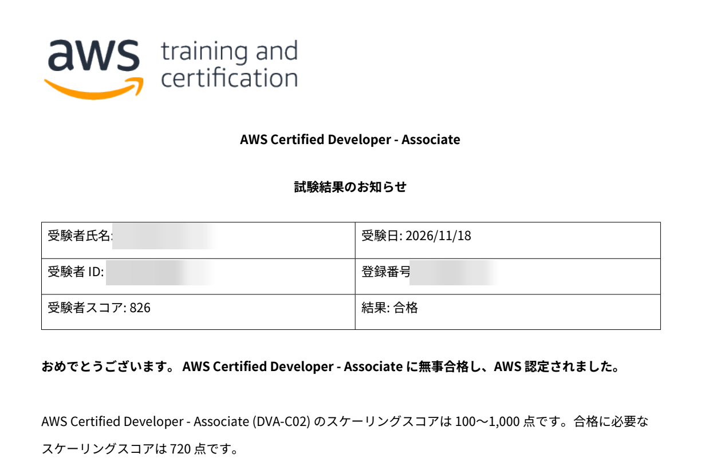

AWS Certified Developer - Associate（DVA-C02）に合格したので、記録として残しておきます。

## 結果

- 受験日: 2026 年 11 月 18 日
- スコア: 826 / 1000（合格ライン 720）
- 勉強期間: 約 2 週間

## 使った教材

- [AWS認定資格試験テキスト AWS認定デベロッパー - アソシエイト](https://www.amazon.co.jp/dp/4815644063)（SBクリエイティブ）
- [Udemy の DVA 対策講座](https://www.udemy.com/share/10cy3v3@-IlUUcPiTNnd4onGqdkAUwm4pz52ZzhiG2_NqTghEnaZdqQ14Vdh53E3BIorALkh8A==/)

## 進め方

1. テキストを 1 回通して読む
2. Udemy で演習し、分からなかった部分をテキストで読み直す（Udemy の問題は各 2 回ずつくらい解いた）
3. 直前に苦手な部分をテキストで読み直す
4. 最後にテキストの演習問題を解いて終わり

## 所感

SAA と比べるとかなり簡単に感じましたが、実際の開発で使うような知識が多く、とてもためになりました。
